  

A janela mostra o clima de Itatiba-SP agora. O monitor rola meus últimos commits; a estante tem um livro para cada linguagem que escrevo.

---

# Olá Eu sou o Kauã Freitas✌️
Bem vindo ao meu perfil GitHub 👋

## Estou aprendendo:

  
      

          

Apaixonado por tecnologia, e por ajudar pessoas através da programação.

Contatos:

   

